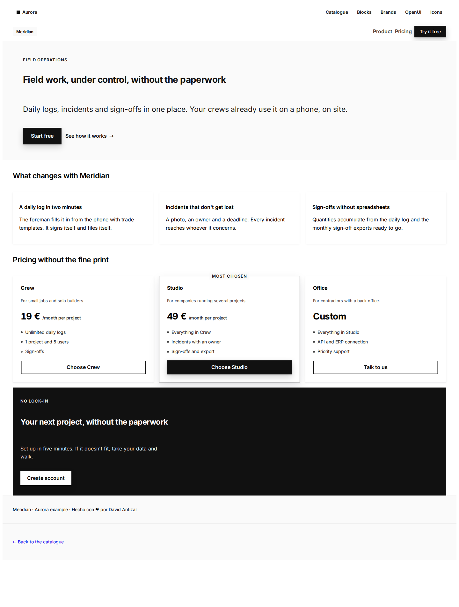
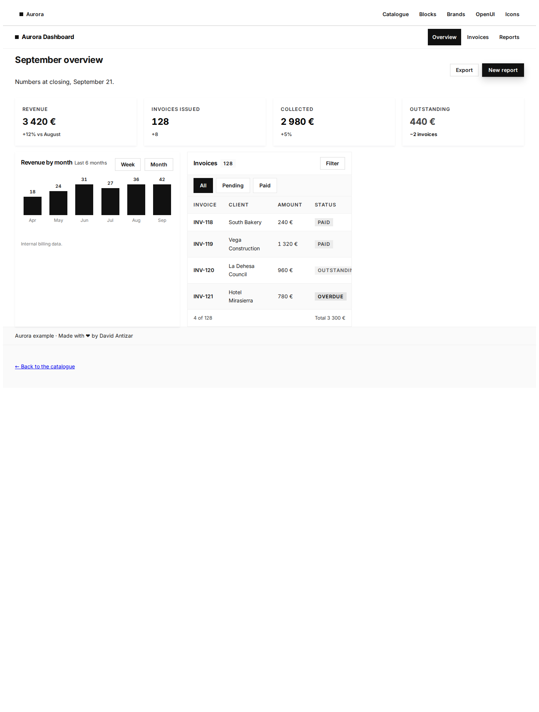
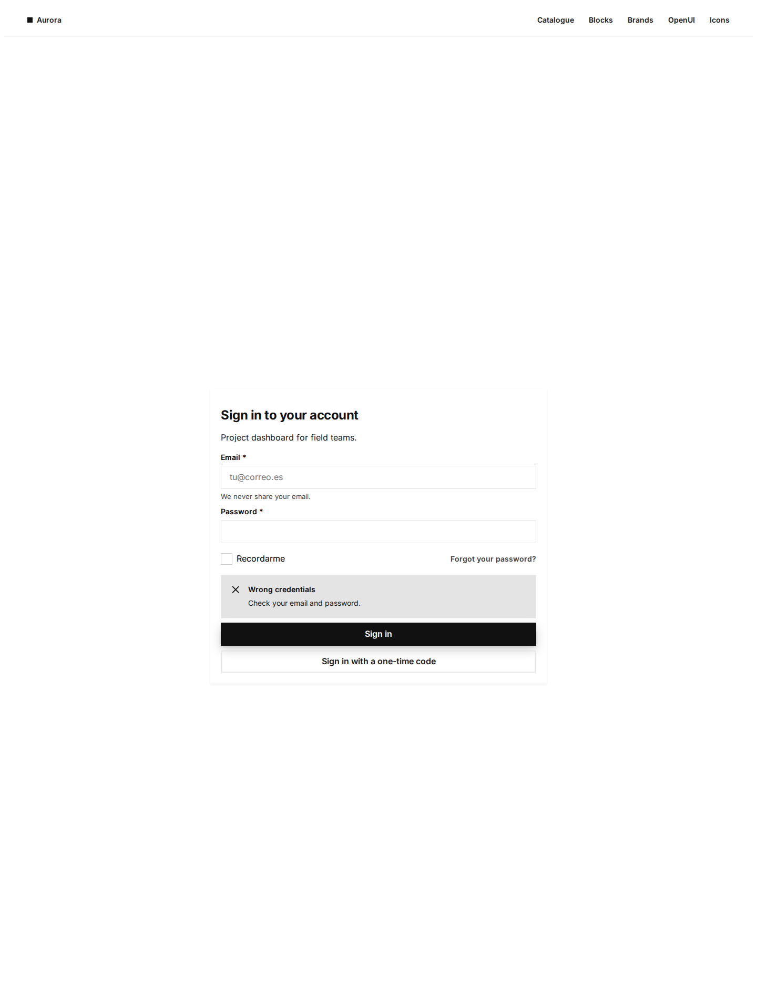

# Aurora para Hermes

**Cuatro skills que enseñan a un agente Hermes a construir interfaz web de verdad con [Aurora](https://github.com/Ntizar/Aurora)** — un design system de CSS puro (sin build, sin JavaScript, sin dependencias) con tokens OKLch, temas claro y oscuro, ~2.200 objetos documentados y 338 iconos numerados.

El agente deja de improvisar CSS: resuelve la versión viva del sistema, decide con tablas en vez de adivinar nombres de clase, y valida la página con el auditor del propio sistema antes de decir «listo».



**Página de lanzamiento con las capturas y el hilo:** <https://ntizar.github.io/hermes-aurora/>

## Instalación

```bash
hermes plugins install aurora-design-system --enable
```

O desde el repositorio:

```bash
hermes plugins install Ntizar/hermes-aurora --enable
```

Sin claves, sin configuración y sin dependencias.

## Las dos herramientas (lo que una skill no puede hacer)

| Herramienta | Qué hace |
|---|---|
| `aurora_search` | Pregunta en lenguaje natural («tabla que se apila en móvil») → familia, pack que hay que enlazar, todas las clases y el **markup real** del catálogo. 2.223 objetos, en proceso. |
| `aurora_validate` | Valida una página contra el censo de clases: inventadas, packs usados pero no enlazados, gradientes, `!important`, colores a mano, emoji en la interfaz, `<h1>` duplicado, pie de atribución ausente. Devuelve `ok`, `fallos`, `avisos`. |

Las dos son offline: leen `data/censo.json`, una foto generada del `components.json` del sistema
(`scripts/generar-censo.py`). Sin red, sin subprocess, sin escrituras, sin hooks: el plugin solo
responde.

Película de demo (70 s, voz y música): [`video/demo8.mp4`](video/demo8.mp4) — guion en [`video/GUION-v8.md`](video/GUION-v8.md).

## Qué trae

| Skill | Cuándo se usa |
|---|---|
| `aurora` | Cualquier página: resolver la versión, enlazar los packs, las 12 reglas duras, tabla necesidad → objeto |
| `aurora-pages` | Elegir la forma: arquetipos, layout, lienzo de escritorio, apilado móvil, tipografía |
| `aurora-validate` | Antes de entregar: auditor + medición en navegador (desborde móvil, estilos computados) |
| `aurora-generative` | Cuando un modelo compone la UI en caliente (openui-lang) en vez de escribir HTML |

Se resuelven como `aurora-design-system:aurora`, etc.

## La idea

Casi todos los plugins de «design system» traen un tema. Este trae **un procedimiento**:

1. **Manda el repo, no el prompt.** El paso 0 resuelve siempre el tag vigente (`git describe --tags --abbrev=0` o la API de GitHub) y lee `LLM.md` y `components.json` generados. Una versión escrita de memoria está mal en cuanto sale una release.
2. **Leer ~20 KB, no ~340 KB.** El agente consulta el censo (`components.json`) para la familia que necesita y copia el markup real, en vez de pegar packs de CSS en el contexto.
3. **No inventar.** Si una clase no está en el censo, no existe. La skill lista las trampas que de verdad cuestan tiempo: `.nz-card`, `nz-text--xs`, un `.nz-switch` sin track/thumb (deja el input inerte), `min-height` en un contenedor cuyo hijo usa `height:100%`.
4. **Medir, no admirar.** La página se entrega cuando el auditor del repo da `0 fallos` *y* el navegador lo confirma: `scrollWidth === clientWidth` a 320/360/390, `display:flex` computado en la navbar, la acción principal por encima del pliegue.

## Por qué es seguro

- **Solo skills.** `register()` publica cuatro `SKILL.md`. Sin tools, sin hooks, sin middleware, sin inyecciones en el system prompt.
- **Sin red, sin ficheros, sin procesos.** El plugin no escribe nada en ejecución; las skills explican cómo pedir la documentación pública del sistema igual que lo haría una persona.
- **Sin auto-actualización.** Las actualizaciones llegan con `hermes plugins update`, sobre un commit revisado.
- **MIT**, la misma licencia que el design system.

```bash
hermes plugins validate ~/.hermes/plugins/aurora-design-system   # puerta de la CI del catálogo
hermes plugins doctor  ~/.hermes/plugins/aurora-design-system    # contratos reales del runtime
```

## Capturas

| Panel | Acceso |
|---|---|
|  |  |

La carpeta `demo/` tiene las tres páginas, sin tocar salvo el enlace al CDN: son los ejemplos canónicos del propio design system, no maquetas dibujadas para un README.

## Requisitos

- Hermes Agent `>= 0.21` (registro de skills desde plugin).
- Nada más. Aurora se sirve desde jsDelivr (canal vivo `@v10`, tag exacto para entregas congeladas).

## Relacionado

- [`Ntizar/Aurora`](https://github.com/Ntizar/Aurora) — el design system: catálogo, `LLM.md`, `components.json`, iconos, auditores.
- Catálogo vivo: <https://ntizar.github.io/Aurora/>

English: [README.md](README.md)

---

Hecho con ❤️ por David Antizar
