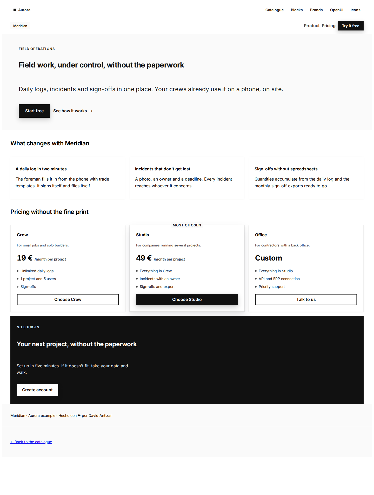
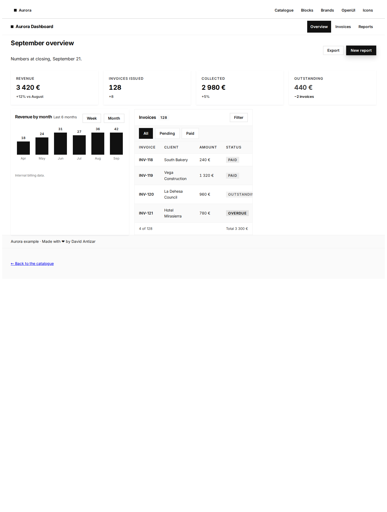
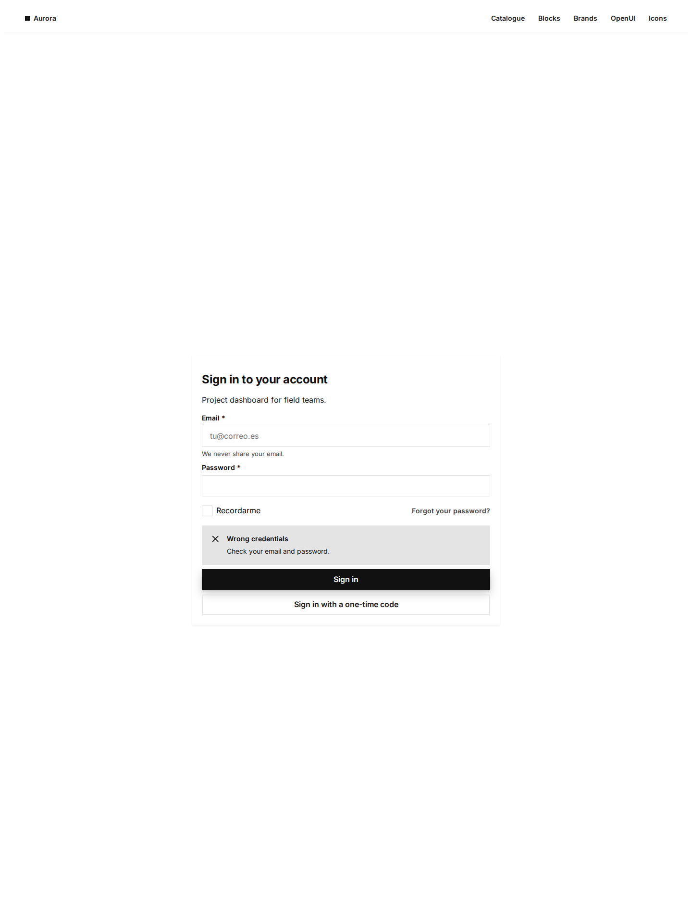

# Aurora for Hermes

**Four skills that teach a Hermes agent to build real web UI with [Aurora](https://github.com/Ntizar/Aurora)** — a pure-CSS design system (no build, no JavaScript, no dependencies) with OKLch tokens, light and dark themes, ~2,200 documented objects and 338 numbered icons.

The agent stops improvising CSS. It resolves the live version of the system, spends time in decision tables instead of guessing class names, and validates the page with the system's own auditor before saying "done".



**Launch page with the demo screenshots and the announcement thread:** <https://ntizar.github.io/hermes-aurora/>

## Install

```bash
hermes plugins install aurora-design-system --enable
```

Or from the repository:

```bash
hermes plugins install Ntizar/hermes-aurora --enable
```

No key, no config, no dependencies. Restart is only needed if your gateway caches the skill index.

## The two tools (the part a skill cannot do)

| Tool | What it does |
|---|---|
| `aurora_search` | Ask in plain words ("table that stacks on mobile") → family, pack to link, every class and the **real markup** from the catalogue. 2,223 objects, in-process. |
| `aurora_validate` | Validate a page against the class census: invented classes, packs used but not linked, gradients, `!important`, hand-written colours, emojis in UI, duplicate `<h1>`, missing attribution. Returns `ok`, `fallos`, `avisos`. |

Both are offline: they read `data/censo.json`, a generated snapshot of the design system's
`components.json` (regenerate with `scripts/generar-censo.py`). No network, no subprocess, no
writes, no hooks — the plugin only answers.

```json
{"familia": "nz-table", "pack": "packs/p8-data.css",
 "clases": ["nz-table", "nz-table--apilable", "..."],
 "markup": "<div class=\"nz-table-wrap nz-table-wrap--apilable\">…"}
```

Demo film (70 s, English voiceover, no music): [`video/demo9.mp4`](video/demo9.mp4) —
storyboard in [`video/GUION-v9.md`](video/GUION-v9.md).

## The recipe (the part anyone can copy)

A design system for agents is not a theme. It is a **contract**, and it has three pieces:

1. **A catalogue** (the census). Publish what exists — every object, every class, the real
   markup — in a machine-readable file. The agent looks it up instead of guessing names.
2. **An inspector** (the validator). Ship a checker that tests a page against that catalogue
   and reports `0 failures` or the exact violations. No proof, no delivery.
3. **Skills.** Teach the procedure (when to use which object, the traps that cost time),
   not a vibe.

Aurora is one implementation of that recipe — its catalogue is `components.json`, its
inspector is `aurora_validate` (backed by `scripts/validar-css.py`), its skills are the four
in this plugin. Page archetypes (landing, dashboard, login, shop, chat, app shell) ship as
skeletons in `bloques/combos/`, so the agent fills a known page instead of inventing one. Fork the mechanism for your
own system: your tokens, your census, your judge. MIT.

## What it ships

| Skill | Use it when |
|---|---|
| `aurora` | Any page: resolve the version, link the packs, the 12 hard rules, need → object table |
| `aurora-pages` | Choosing the shape: archetypes, layout, desktop canvas, mobile stacking, typography |
| `aurora-validate` | Before delivering: auditor + browser measurement (mobile overflow, computed styles) |
| `aurora-generative` | A model composes the UI at runtime (openui-lang) instead of writing HTML |

They resolve as `aurora-design-system:aurora`, etc.

## The idea

Most "design system" plugins ship a theme. This one ships **a procedure**:

1. **The repo is the source of truth, not the prompt.** Step 0 always resolves the current tag (`git describe --tags --abbrev=0` or the GitHub API) and reads the generated `LLM.md` and `components.json`. A version written from memory is wrong the moment a release lands.
2. **Read ~20 KB, not ~340 KB.** The agent queries the census (`components.json`) for the family it needs and copies the real markup, instead of pasting CSS packs into the context.
3. **Do not invent.** If a class is not in the census it does not exist. The skill lists the traps that actually cost time: `.nz-card`, `nz-text--xs`, a `.nz-switch` without track/thumb (leaves the input inert), `min-height` on a container whose child uses `height:100%`.
4. **Measure, don't admire.** A page is delivered when the repo auditor reports `0 fallos` *and* the browser agrees: `scrollWidth === clientWidth` at 320/360/390, computed `display:flex` on the navbar, the primary action above the fold.

## Why it is safe

- **Skills only.** `register()` publishes four `SKILL.md` files. No tools, no hooks, no middleware, no system-prompt injections.
- **No network, no files, no processes.** The plugin writes nothing at runtime; the skills tell the agent how to fetch the design system's public docs the same way a human would.
- **No self-update.** Updates arrive through `hermes plugins update` at a reviewed commit.
- **MIT**, same licence as the design system.

```bash
hermes plugins validate ~/.hermes/plugins/aurora-design-system   # catalog CI gate
hermes plugins doctor  ~/.hermes/plugins/aurora-design-system    # real runtime contracts
```

## Screenshots

| Dashboard | Login |
|---|---|
|  |  |

The `demo/` folder holds the three pages, unmodified apart from the CDN link — they are the design system's own canonical examples, not mock-ups drawn for a README.

## Requirements

- Hermes Agent `>= 0.21` (plugin skill registration).
- Nothing else. Aurora itself is served from jsDelivr (`@v10` living channel, exact tags for frozen deliveries).

## Related

- [`Ntizar/Aurora`](https://github.com/Ntizar/Aurora) — the design system: catalogue, `LLM.md`, `components.json`, icons, auditors.
- Live catalogue: <https://ntizar.github.io/Aurora/>

Versión en castellano: [README.es.md](README.es.md)

---

Hecho con ❤️ por David Antizar
